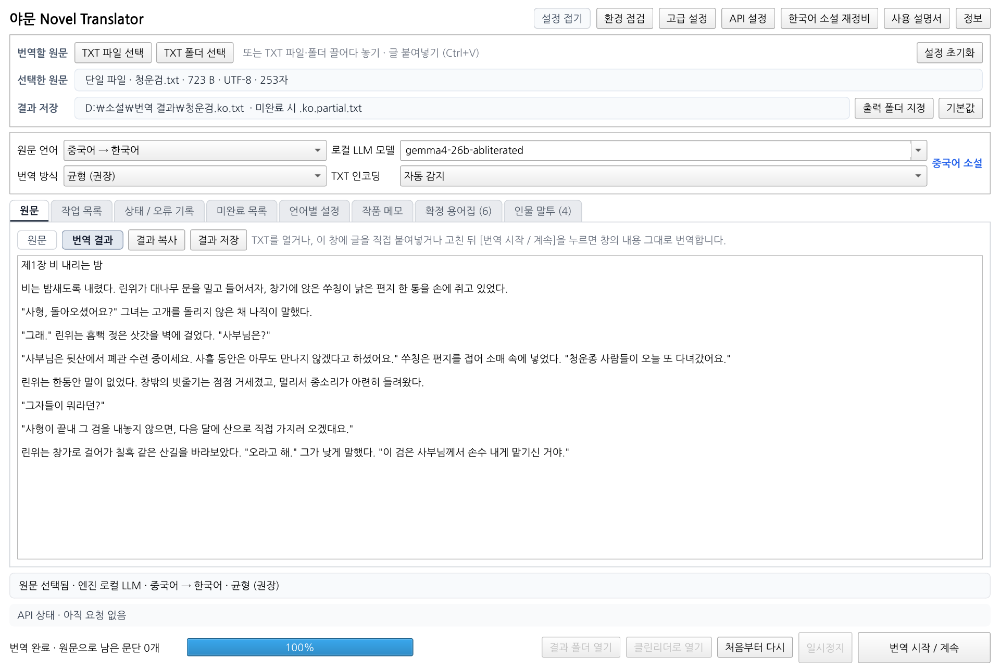
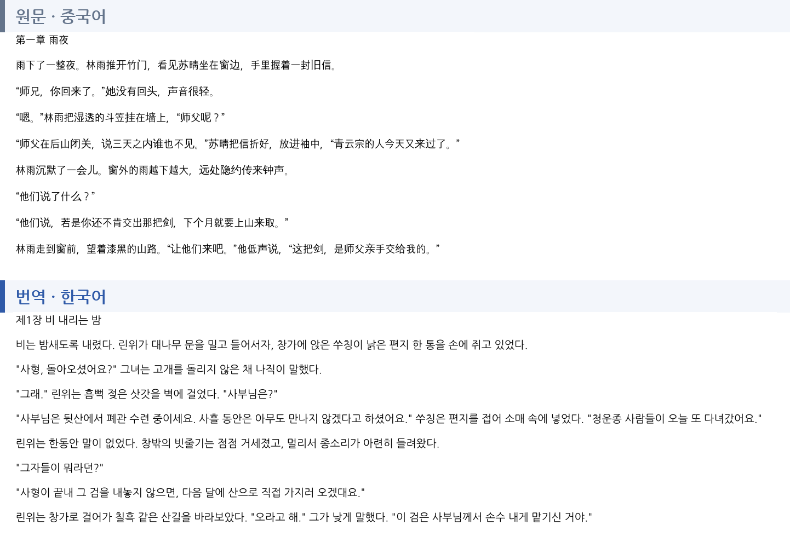
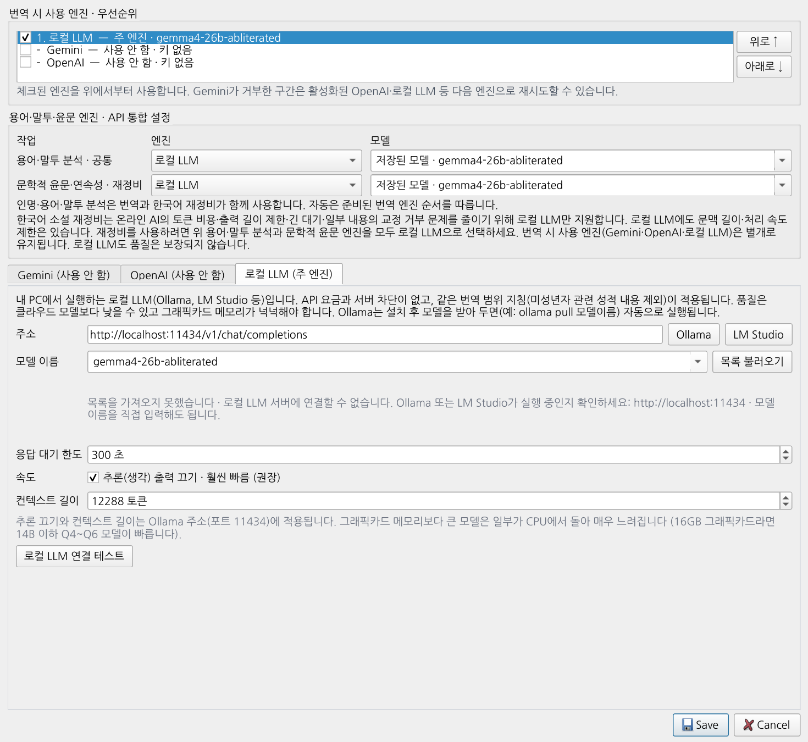
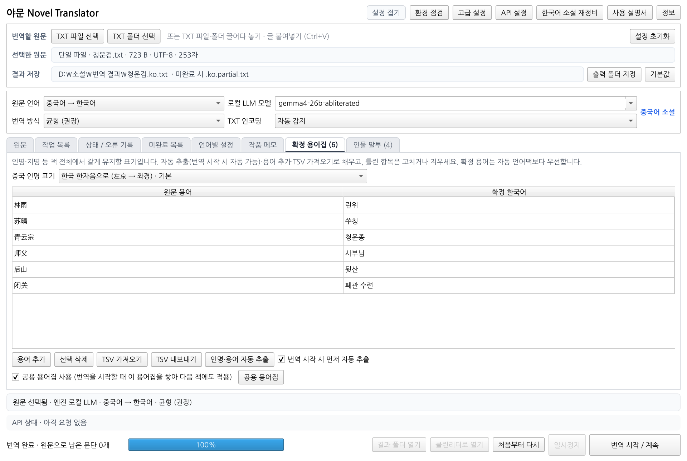
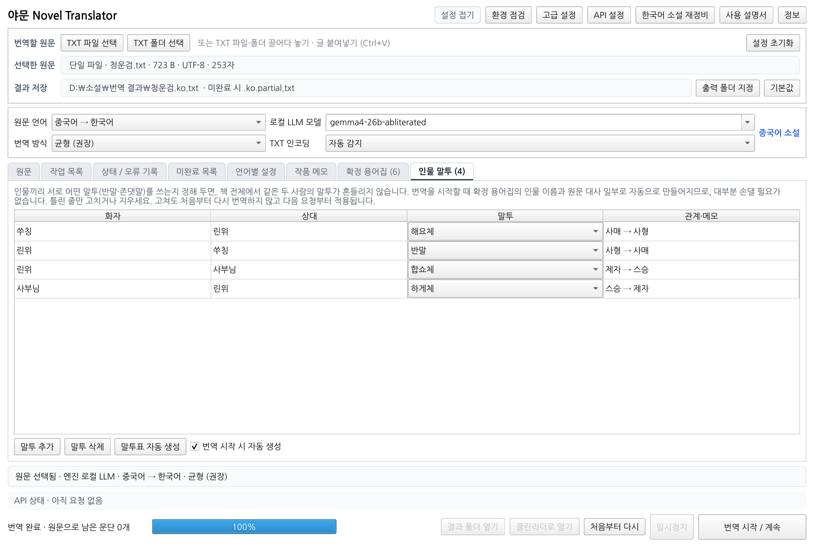
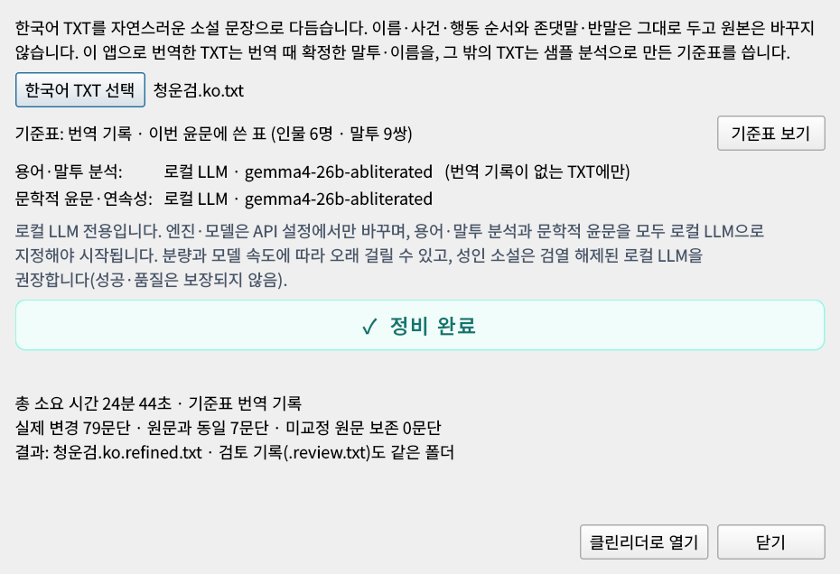

<div align="center">

# 야문 Novel Translator

**치장하지 않는다. 각색하지 않는다. 빠뜨리지 않는다.**

중국어 · 일본어 · 영어 소설과 문서(TXT · PDF · EPUB)를 원문 그대로의 뜻과 수위, 문체로 한국어에 옮기는<br>
**로컬 LLM 중심**의 Windows 소설 번역 프로그램

<sub>A local-LLM-first Windows app that translates Chinese, Japanese and English novels (TXT · PDF · EPUB) into Korean — faithfully, without embellishment or omission. · <a href="#english">English summary</a></sub>

[](https://github.com/Yamoon-jjang/Yamoon-Novel-Translator/releases/latest)
-7c3aed)


[](LICENSE)



</div>

---

## 이 프로그램이 지키는 것

요즘 AI 번역은 막힘없이 매끄럽게 읽힙니다. 하지만 원문과 나란히 놓고 보면 다른 경우가 많습니다. **원문에 없는 수식이 덧붙고, 문장이 작가의 글과 다르게 각색되고, 때로는 원문에 없는 내용이 새로 만들어집니다.** 검열을 피하려고 단어를 가리거나 바꿔 보내는 방식은 뜻이 어긋날 위험을 더 키웁니다.

물론 그렇게 다듬어진 글은 읽기 편하고 부드럽게 느껴질 수 있고, 번역문만 자연스러우면 충분하다는 분도 많습니다. 다만 그 글은 **원문과 다릅니다.**

야문 Novel Translator는 작가가 쓴 그대로를 읽고 싶은 분을 위해, 이런 차이를 **최대한 줄이는 것**을 목표로 만들었습니다.

- **치장하지 않는다** — 원문에 없는 수식이나 미사여구를 붙이지 않고, 작가의 문체와 호흡을 그대로 옮깁니다.
- **각색하지 않는다** — 뜻과 수위를 바꾸지 않습니다. 거친 대사는 거칠게, 성인 장면은 원문의 수위 그대로 옮깁니다. 미성년자가 관련된 성적 내용만 번역에서 제외합니다.
- **없는 내용을 만들지 않고, 있는 내용을 빠뜨리지 않는다** — 모든 문단에 번호를 붙여 보내고, 같은 번호가 하나도 빠짐없이 그대로 돌아왔는지 검사합니다. 원문에 없는 생략 표기나 남은 한자 · 가나도 잡아냅니다.
- **원문을 바꿔 보내지 않는다** — 검열을 피하려고 단어를 가리거나 바꿔치기하거나 프롬프트로 속이지 않습니다. 원문은 원문 그대로 보냅니다. 그래서 온라인 AI에서는 거부되는 문단이 생길 수 있고, 이 때문에 **로컬 LLM을 주 엔진으로** 설계했습니다.



<sub>화면 예시 — 원문 문단 하나하나가 번역문 문단 하나하나와 그대로 대응합니다. 인명 · 지명 · 호칭은 확정 용어집대로, 사형↔사매 · 제자↔스승의 말투는 인물 말투표대로.</sub>

## 왜 로컬 LLM이 주인공인가

Gemini · GPT 같은 온라인 AI는 빠르고 똑똑하지만, 원문을 있는 그대로 보내면 서비스 정책에 걸리는 장면에서 번역을 거부하는 일이 잦습니다. 원문을 고쳐 보내지 않는 이 프로그램에서는 그만큼 원문으로 남는 문단이 생깁니다.

그래서 이 프로그램은 **내 PC에서 돌아가는 로컬 LLM([Ollama](https://ollama.com))을 주 엔진으로** 설계했습니다. Gemini · GPT는 속도가 필요할 때 거드는 보조 엔진입니다.

| | 로컬 LLM (주 엔진) | Gemini · GPT (보조) |
|---|---|---|
| 원문 그대로 보낼 때 | 모델에 따라 **거부 없이 끝까지** | 정책에 걸리는 장면은 거부되는 경우가 잦음 |
| 비용 | 없음 | 사용량만큼 요금 |
| 원고 | **PC 밖으로 나가지 않음** | 서비스 서버로 전송 |
| 하루 한도 · 서버 차단 | 없음 | 있음 |
| 속도 | 그래픽카드에 따라 다름 | 빠름 |

> **실측 예** — 거부가 많도록 일부러 고른 400KB 중국어 성인 소설: 67청크 중 **31청크가 Gemini에서 막혔지만**, 막힌 문단을 로컬 LLM이 이어받아 최종적으로 원문으로 남은 것은 **단 1문단**이었습니다.

**권장 모델: Gemma 4 26B 이상의 거부 해제(abliterated) 모델.** 응답 거부 성향을 줄인 모델이라 번역은 물론 인명 · 용어 추출, 인물 말투표, 한국어 소설 재정비까지 **거부 걱정 없이 끝까지 쓸 수 있습니다.** 개발 중 실제 번역과 재정비를 이 모델로 확인했으며 16GB 그래픽카드에서 동작합니다. 메모리가 부족하면 Gemma 4 12B도 쓸 수 있습니다.

> 거부된 문단은 원문 그대로 엔진 순서의 다음 엔진에 넘길 뿐, 단어 가리기 · 바꿔치기 · 가짜 대화 기록 같은 우회는 하지 않습니다. 어떤 모델이든 미성년자 관련 성적 내용은 번역에서 제외되며, 모델의 선택 · 사용과 라이선스 준수는 사용자의 책임입니다.

## 정확한 번역을 위한 장치

### 로컬 LLM이 문단을 빠뜨리지 못하게

Ollama에는 **보낸 문단 번호가 모두 들어간 형식(구조화 출력)으로만** 답하도록 지정합니다. 모델이 문단을 건너뛰거나 두 문단을 하나로 합치기 어렵게 만드는 장치입니다. 그래도 하나가 빠지면 나머지 번역은 살리고 **빠진 문단만** 다시 요청합니다. Gemma 계열에는 Google 권장 샘플링 값을 요청마다 적용합니다.



<sub>로컬 LLM을 1순위로, Gemini · OpenAI는 필요할 때만. 용어 · 말투 분석과 재정비 윤문 엔진도 따로 고를 수 있습니다.</sub>

### 이름은 끝까지 같게, 말투는 흔들리지 않게

<table>
<tr>
<td width="50%"></td>
<td width="50%"></td>
</tr>
<tr>
<td><sub><b>확정 용어집</b> — 번역을 시작할 때 인명 · 지명 · 문파 이름을 자동으로 뽑아 고정합니다. 책마다 쌓이는 <b>공용 용어집</b>은 다음 책에도 그대로 쓰입니다. 번역 뒤 한국어 표기만 고치면 다시 번역하지 않고 저장된 번역의 이름과 조사만 바꾸며, "하늘색"처럼 이름으로 시작하는 다른 낱말은 건드리지 않습니다.</sub></td>
<td><sub><b>인물 말투표</b> — 중국어 · 영어에는 존댓말 문법이 없어 청크마다 말투가 흔들립니다. 누가 누구에게 반말 · 해요체 · 합쇼체 · 하게체를 쓰는지 한 번 정해 책 전체에 적용합니다. 만드는 동안 엔진과 경과 시간이 표시되고, 기다리기 싫으면 건너뛰고 바로 번역할 수 있습니다. 1인칭 소설은 화자가 아들인지 딸인지에 따라 姐를 누나 · 언니로, 哥를 형 · 오빠로 맞춰 옮깁니다.</sub></td>
</tr>
</table>

### 끊겨도, 거부돼도, 이어서

- **거부 대응 사다리** — 거부 · 차단이 나면 이전 문맥을 빼고 한 번 더, 그래도 막히면 문단 단위로 좁혀 **엔진 순서의 다음 엔진**이 이어받습니다. 성공한 문단은 절대 버리지 않습니다.
- **번역 기억** — 조금씩 저장하며 번역하므로 중간에 멈추거나 PC가 꺼져도 번역한 곳부터 이어집니다. 파일 이름을 바꿔도 내용이 같으면 이미 번역한 부분은 다시 요청하지 않습니다.
- **원본 보호** — 원본 파일은 고치지 않습니다. 결과는 `파일이름.ko.txt`, 덜 끝났으면 `파일이름.ko.partial.txt` (원문으로 남은 부분까지 빠짐없이 포함). PDF · EPUB으로 연 책도 같습니다.
- **폴더 통째로** — 폴더 안의 TXT · PDF · EPUB을 순서대로 끝까지, 하위 폴더 구조 그대로. 파일마다 미번역 부분을 자동으로 다시 번역하고, 그래도 남은 것만 마지막에 모아 알려 줍니다.
- **설정을 바꿔도 이어서** — 중지한 뒤 용어집 · 작품 메모 · 번역 방식을 바꾸거나 새 버전으로 바꿔도, 이미 번역한 부분을 버리기 전에 무엇이 바뀌었는지 보여 주고 **이어서 번역할지 먼저 묻습니다.** 수천 청크짜리 책도 이어 번역 준비가 1~2초면 끝납니다.
- **멈추면 바로 멈춘다** — [번역 중지]를 누르면 로컬 LLM이 쓰던 답도 그 자리에서 끊겨, 그래픽카드가 쓸모없는 생성을 계속하지 않고 다음 작업이 기다리지 않습니다. [일시정지]는 받던 답까지 저장한 뒤 멈춥니다.

### PDF · EPUB도 그대로

- **글자만 꺼내 TXT처럼** — PDF · EPUB을 열면 본문 글자만 꺼내 원문 창에 넣고, 그다음은 TXT와 똑같이 번역합니다. 용어집 · 말투표 · 이어 번역도 같습니다.
- **빠르게 열기** — 긴 PDF는 CPU 코어 여러 개가 쪽을 나눠 글자를 꺼내고, 한 번 꺼낸 글은 보관해 같은 PDF를 다시 열면 바로 열립니다.
- **PDF 정리** — 쪽마다 반복되는 머리글 · 꼬리글과 쪽 번호를 지우고, 쪽 너비 때문에 끊긴 줄을 문단으로 다시 잇습니다. 장 제목은 한 줄로 둡니다. 글자 정보가 없는 스캔 PDF는 **문자 인식(OCR)이 필요한 PDF**라고 알려 줍니다.
- **EPUB** — 책의 읽는 순서대로 문단 · 장 제목을 꺼내고, 일본어 루비(후리가나)는 빼고 본문만 남깁니다. 복제 방지(DRM)가 걸린 전자책은 열지 않습니다.
- **저장** — 자동 저장은 언제나 `.ko.txt`. 원하면 [결과 저장]에서 한글 글꼴로 새로 짠 **읽기용 PDF**(문단 간격 · 장 제목 · 쪽 번호)나 **읽기용 EPUB**(장별 목차)으로도 저장합니다. 원본의 모양을 따라 하지는 않습니다.

### 한국어 소설 재정비



이미 번역된 한국어 TXT의 직역투 · 어순 · 조사 · 대사 흐름을 **로컬 LLM이 자연스러운 소설 문장으로** 다듬습니다. 줄거리 · 인물 관계 · 사건은 바꾸지 않으며, 끝나면 실제로 바뀐 문단 · 그대로 둔 문단 · 총 소요 시간을 보고합니다.

- **번역할 때의 말투표를 그대로** — 이 앱으로 번역한 TXT는 번역에 실제로 쓴 인물 말투표와 확정 이름 · 용어를 기준표로 삼아, 다듬는 중에 존댓말 · 반말이나 이름이 흔들리지 않게 합니다. 다른 TXT는 샘플 분석으로 기준표를 만들며, 어느 쪽을 쓰는지 창과 검토 기록에서 확인할 수 있습니다.
- **바뀌면 안 되는 것을 지킨다** — 분량, 대사의 존댓말 · 반말, 확정 이름에 변화가 의심되면 한 번 더 비교해 확인하고, 문제가 있거나 **확인하지 못했으면 원문을 그대로 둡니다.** 확인되지 않은 윤문은 결과에 넣지 않습니다. 남은 한자 · 가나는 한국어로 옮깁니다.
- **못 다듬은 문단만 다시** — 끝난 뒤 원문으로 둔 문단은 같은 TXT로 다시 시작하면 그 문단만 다시 시도합니다.
- **끝나면 클린리더로** — 재정비가 끝나면 [클린리더로 열기]로 다듬은 결과를 [야문 클린리더](https://github.com/Yamoon-jjang/Yamoon-CleanReader)에서 바로 엽니다.

<sub>스크린샷은 기능을 보여 주기 위한 화면 예시입니다.</sub>

## 주요 기능 한눈에

- 중국어 · 일본어 · 영어 → 한국어, TXT · PDF · EPUB을 열거나 글을 붙여넣으면 원문 언어 자동 인식
- 엔진 1~3개를 원하는 순서로 (로컬 LLM · Gemini · OpenAI), Gemini 키는 최대 10개까지 순서대로 돌려 쓰기
- 문단 번호 검증, 생략 · 순화 흔적 감지, 남은 한자 · 가나 감지, 미완료 구간 재시도
- 확정 용어집 자동 추출 · 공용 용어집 · 인물 말투표 · 작품 메모 · 번역 지침 (용어가 수백 개인 긴 책은 요청마다 그 원문에 나오는 용어만 보내 가볍게)
- 서로 다른 인물이 같은 한글 이름으로 추출되면(Susan · Suzanne → 둘 다 "스잔") 번역 전에 알려 고치게 하고, 고친 이름은 인물 말투표에도 그대로 반영
- 모델 고르기 · 양자화 · VRAM · 컨텍스트 설정부터 용어집 · 말투표 · 재정비 요령까지 담은 **자세한 사용 설명서**(프로그램의 [사용 설명서] 버튼)
- 번역 결과 실시간 보기, 붙여넣은 글 바로 번역, 출력 폴더 지정, 창 위치 · 크기 기억
- 사용량 · 예상 비용 표시, 한국어 소설 재정비, [야문 클린리더](https://github.com/Yamoon-jjang/Yamoon-CleanReader)로 바로 열어 문단 정리 · 읽기

## 내려받기와 실행

1. **[Releases](https://github.com/Yamoon-jjang/Yamoon-Novel-Translator/releases/latest)** 에서 최신 `Yamoon-Novel-Translator-…-Windows-Portable.zip`을 받습니다.
2. zip 파일을 오른쪽 클릭 → 속성 → **차단 해제**에 체크한 뒤 원하는 폴더에 풉니다. (설치 과정은 없습니다)
3. `NovelTranslator.exe`를 실행합니다. Windows가 "PC 보호" 창을 띄우면 **추가 정보 → 실행**을 누릅니다. 코드 서명을 하지 않은 개인 제작 프로그램이라 나오는 안내입니다.
4. **[Ollama](https://ollama.com)** 를 설치하고 모델을 받은 뒤, 오른쪽 위 **API 설정**에서 로컬 LLM을 1순위로 둡니다. Ollama를 켜 두면 등록된 모델 목록을 자동으로 불러옵니다. 설치부터 모델 등록까지는 `사용설명서.html` **11장**에 단계별로 있습니다.

- 지원: Windows 10 / 11 (64비트) · 로컬 LLM은 그래픽카드 메모리 16GB 권장
- Gemini · OpenAI를 쓸 경우 이용료와 약관은 각 서비스를 따릅니다.

## 소스에서 빌드하기

Windows에서 Python 3.12로 빌드합니다.

```bat
cd app
python -m pip install -r requirements-build.txt
build_windows.bat
```

`build_windows.bat`은 자동 테스트(780여 개)와 점검을 모두 통과해야 `app\dist\NovelTranslator\`에 실행 파일을 만듭니다.
GitHub Actions(`.github/workflows/build.yml`)도 같은 과정으로 빌드하며, 새 버전이 main에서 모든 점검을 통과하면 Releases에 배포본을 자동으로 올립니다.

---

<a id="english"></a>

## English

**Yamoon Novel Translator** is a Windows desktop app that translates **Chinese, Japanese and English novels and documents (TXT, PDF, EPUB) into Korean**. It is built around a **local LLM via [Ollama](https://ollama.com)** as the main engine, with Google Gemini and OpenAI as optional secondary engines.

Its goal is faithful translation: no embellishment, no rewriting, no omissions. The source text is always sent as-is — never masked or altered to get past content filters — which is why a local model is the primary engine.

- **No missing paragraphs** — every paragraph is numbered and checked on return; Ollama is asked for structured output, and any missing paragraph is re-requested on its own
- **Consistent names** — glossary of names, places and terms is extracted automatically and shared across books
- **Consistent Korean speech levels** — a character speech-level table (honorific / casual, etc.) is applied across the whole book
- **Refusal fallback** — refused paragraphs move to the next engine in your chosen order; successful paragraphs are never discarded
- **Resumable** — translation memory lets you stop and continue (if you change the glossary or other job settings in between, the app shows what changed and asks before re-translating anything already done); untranslated parts are retried automatically (also for every file in a folder run), and only what is still left is reported; source files are never modified
- **PDF / EPUB** — text extraction with header, footer and page-number cleanup and ruby (furigana) removal; export to reader-friendly PDF or EPUB
- **Korean refinement** — polishes already-translated Korean text into natural prose with a local LLM, keeping plot, names and speech levels intact; a passage whose suspected change could not be checked keeps the original and can be retried later
- **Stop means stop** — stopping a job also closes the running local LLM request, so Ollama stops generating right away
- **Safe name changes** — changing only the Korean spelling of a name updates the stored translation without re-translating, and leaves words that merely start with the name untouched
- Sexual content involving minors is always excluded from translation

Download the portable zip from [Releases](https://github.com/Yamoon-jjang/Yamoon-Novel-Translator/releases/latest). Requires Windows 10/11 (64-bit); 16 GB of VRAM is recommended for the local LLM. The interface and manual are in Korean.

---

## 라이선스 · 이용 안내

[MIT License](LICENSE) — 누구나 무료로 사용 · 수정 · 재배포할 수 있으며, 저작권 표시는 유지해야 합니다.
배포본에 포함된 Qt(PySide6, LGPL-3.0), pypdf(BSD-3-Clause) 등 외부 구성 요소의 라이선스는 [THIRD_PARTY_NOTICES.txt](app/THIRD_PARTY_NOTICES.txt)에 있습니다.

- 이 프로그램은 번역 **도구**입니다. 번역할 작품의 저작권과, 번역 결과를 공유 · 배포하는 데 따르는 책임은 사용자에게 있습니다.
- 이 프로그램은 있는 그대로 제공되며, 사용으로 생긴 문제에 대해 제작자는 책임지지 않습니다. 중요한 파일은 미리 백업해 두세요.

<div align="center"><sub>제작 · 야문 짱 &amp; Claude (협동작)</sub></div>
